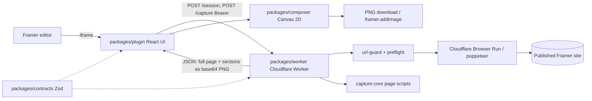
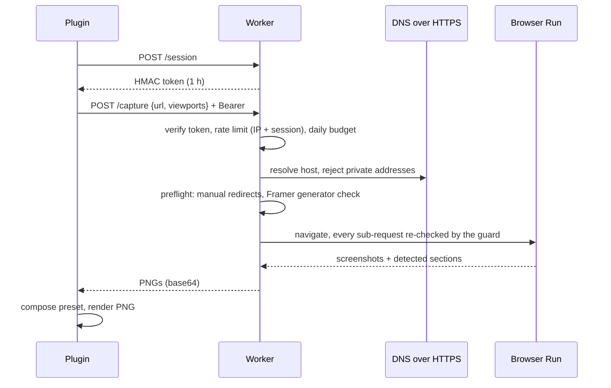

# Framer Site Capture Plugin

A Framer editor plugin that captures a published Framer site (desktop and mobile) and composes presentation-ready PNG mockups for portfolios, using a Cloudflare Worker as a hardened headless-browser gateway.

Status: prototype, not published to the Framer Marketplace. The worker has not been deployed from this repository; licence/webhook routes are written but inactive until configured. The product is internally named SitePromo (package scope `@sitepromo/*`).

## What it does

- Reads the open Framer project (name, published URL, pages, colour styles, fonts) through the Framer Plugin SDK (`packages/plugin/src/framer/project.ts`).
- Captures a published page at desktop (1440x900) and mobile (390x844) viewports, full page plus up to 6 detected sections (`packages/worker/src/capture.ts`, `packages/capture-core`).
- Freezes motion and reveals appear-on-scroll elements before screenshots so captures are stable.
- Composes three presets (hero, devices, sections) on a deterministic Canvas 2D composer, themed from the project palette (`packages/composer/src/presets.ts`).
- Exports PNG at 1x/2x/3x, verified by header and dimensions before delivery, or inserts the image on the Framer canvas (`packages/plugin/src/export.ts`).
- Protects the capture endpoint against SSRF, abuse and runaway cost (see decisions below).

## Architecture





- `plugin` is untrusted UI in an iframe; it only talks to the worker through `contracts` schemas.
- `worker` is the only component that navigates to third-party URLs; no database, storage or queue in the MVP (`docs/decisions/ADR-0002-capture-security-and-infra.md`).
- `capture-core` holds page scripts that are serialised and evaluated in the browser, so they stay self-contained.
- `composer` is pure drawing code with no Framer or network dependency.

## Key engineering decisions

- SSRF defence in depth: URL structure checks, hostname policy, DNS-over-HTTPS with private-range rejection, and the same guard on every browser request, so DNS rebinding and redirects cannot bypass it (`packages/worker/src/url-guard.ts`, 77 tests in `url-guard.test.ts`).
- Preflight follows redirects manually (max 3 hops), re-validating each, and requires a Framer generator meta on custom domains (`packages/worker/src/preflight.ts`).
- Cost controls: HMAC session token, rate limit per IP and session, daily browser-time budget in KV charged on failures too, and a kill switch (`packages/worker/src/index.ts`, `token.ts`). The KV budget is a soft cap and can overshoot under bursts.
- Canvas 2D instead of server-side rendering keeps composition deterministic and free of worker cost (`docs/decisions/ADR-0004-composer-canvas2d.md`).
- Synchronous base64 response, no R2 or queue, until measured usage justifies them (ADR-0002).
- Visual regression of the composer against baselines generated from synthetic fixtures (`tests/visual`, `tests/fixtures/sites/make-fixtures.mjs`).

## Tech stack

TypeScript, pnpm workspace, React 18 + Vite, Framer Plugin SDK 5, Cloudflare Workers (Browser Run, rate limiting, KV), `@cloudflare/puppeteer`, Zod, fflate, Vitest, Playwright, Biome.

## Getting started

Prerequisites: Node 22+, pnpm 10, Framer desktop for loading a development plugin, a Cloudflare account with Browser Run for the worker.

```bash
pnpm install --frozen-lockfile
pnpm worker:dev     # local worker
pnpm plugin:dev     # plugin dev server, load it in Framer as a development plugin
```

| Variable | Where | Purpose |
| --- | --- | --- |
| `VITE_WORKER_URL` | plugin | Base URL of the capture worker |
| `SESSION_SECRET` | worker secret | HMAC key for session tokens (`packages/worker/.dev.vars.example`) |
| `ALLOWED_ORIGIN` | worker | Origin allowed by CORS |
| `CAPTURE_ENABLED`, `DAILY_BROWSER_BUDGET_MS` | worker vars | Kill switch and daily budget (`wrangler.jsonc`) |
| `LEMON_WEBHOOK_SECRET` | worker secret, optional | Enables the inactive licence/webhook routes |

## Testing

88 Vitest tests pass locally (`pnpm test`): 86 in the worker (URL guard, preflight, token, licence) and 2 visual regression tests for the composer (Playwright with a local Chrome; baselines in `tests/visual/__baseline__`). `pnpm typecheck` is clean. `pnpm lint` (Biome) still reports errors that have not been triaged, and CI treats it as advisory. No CI badge is shown.

## Project structure

```text
packages/
  plugin/        Framer plugin UI and SDK integration
  worker/        Cloudflare Worker capture gateway
  capture-core/  In-page scripts and section detection
  composer/      Canvas 2D presets and PNG export
  contracts/     Shared Zod schemas
tests/           Visual regression and synthetic site fixtures
docs/            Architecture, ADRs, UI spec, security and export spikes
```

## License

All rights reserved. Source available for portfolio review.
